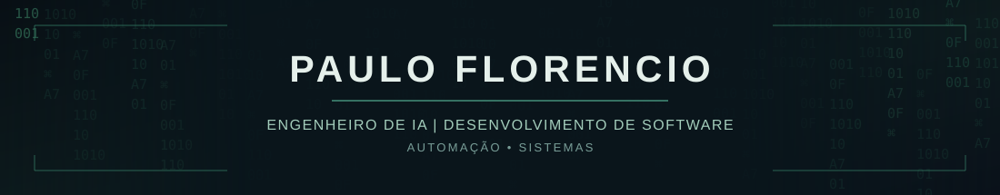

  

**[E-mail](mailto:pauloalmeida1478965@gmail.com) · [WhatsApp / Telefone](tel:+5511978988489) · [GitHub](https://github.com/phzl0)**

Desenvolvimento de software · Integração de sistemas · Dados e automação

[Sobre](#sobre-mim) · [Competências](#competências-técnicas) · [IA](#inteligência-artificial-e-automação) · [Projetos](#projetos) · [Formação](#formação)

---

## Sobre mim

Sou estudante de tecnologia na **FATEC**, com formação técnica em Tecnologia da Informação e experiência em operações digitais, e-commerce e processos administrativos.

Tenho interesse em **desenvolvimento backend, aplicações web, integração de APIs, bancos de dados e automação de processos**, buscando conectar soluções técnicas a necessidades reais de negócios.

Desenvolvo projetos próprios para aprofundar conhecimentos em **arquitetura de software, infraestrutura, integração de serviços e aplicações de inteligência artificial**, com foco em experimentação, documentação e melhoria contínua.

---

## Competências técnicas

| Área | Tecnologias e conhecimentos |
| :--- | :--- |
| **Desenvolvimento** | Java, JavaScript, HTML, CSS, Spring Boot |
| **Backend e integrações** | APIs REST, Node.js, integração de sistemas |
| **Dados** | SQL, PostgreSQL, MySQL, fundamentos de MongoDB |
| **Ambiente e infraestrutura** | Linux / Ubuntu, Git, GitHub, Docker |
| **Operações e produtividade** | Excel, Microsoft Office, ERP, CRM, e-commerce |

**Conhecimentos básicos e em desenvolvimento**

`Python` `Cloud Computing` `AWS` `Arquitetura de sistemas` `APIs e integrações`

---

## Inteligência artificial e automação

Estudo os fundamentos e as aplicações de **modelos de linguagem, agentes de IA, integração de ferramentas e automação inteligente**.

| Conceito | Conhecimentos em desenvolvimento |
| :--- | :--- |
| **LLM — Large Language Model** | Modelos de linguagem, prompts, inferência e APIs |
| **Agentes de IA** | Ferramentas, execução supervisionada e fluxos com modelos |
| **MCP — Model Context Protocol** | Protocolo para conectar aplicações de IA a ferramentas e fontes de dados |
| **RAG — Retrieval-Augmented Generation** | Recuperação de informações externas para fundamentar respostas |
| **CLI — Command-Line Interface** | Ferramentas de linha de comando, terminal Linux e fluxos de desenvolvimento |
| **Automação de processos com IA** | Orquestração, integrações e execução de rotinas assistidas por modelos |

**Experimentação prática:** `Ollama` · `Goose` · `Ruflo`

Conhecimentos introdutórios e experimentação prática; esta seção não indica certificação ou especialização profissional nessas tecnologias.

---

## Projetos

<table>
<tr>
<td width="50%" valign="top">
<h3><a href="https://github.com/phzl0/Ecommerce">Ecommerce</a></h3>

Aplicação de comércio eletrônico em Java e Spring Boot, com persistência de dados e funcionalidades de operação comercial.

<b>Foco:</b> backend, bancos de dados, segurança e implantação.

<b>Status:</b> demonstração funcional; funcionalidades em evolução.

<a href="https://ecommerce-kbri.onrender.com">Aplicação publicada</a>
</td>
<td width="50%" valign="top">
<h3><a href="https://github.com/phzl0/QuestLog">Progress Hub</a></h3>

Plataforma de acompanhamento e engajamento de desenvolvedores, com atividades do GitHub, progresso, objetivos e comunidade.

<b>Foco:</b> integração com GitHub, aplicações web e gamificação.

<b>Origem:</b> evolução de um projeto open-source (QuestLog).

<a href="https://progress-hub-ten.vercel.app/">Aplicação publicada</a>
</td>
</tr>
</table>

### Command Center — Em planejamento

Plataforma de inteligência e gestão profissional pessoal, projetada com **Python, FastAPI, PostgreSQL e React**. Escopo previsto: dashboard, planilhas, relatórios, projetos, agenda e futuras integrações com agentes de IA.

Funcionalidades planejadas, ainda não entregues.

---

## Atividade no GitHub

Indicadores gerados por serviços de terceiros a partir de informações públicas; disponibilidade sujeita ao serviço.

---

## Formação

- **FATEC** — graduação tecnológica em andamento.
- **Ensino Médio Técnico em Tecnologia da Informação**.
- **Estudos atuais:** Python, arquitetura backend, bancos de dados, computação em nuvem, agentes de IA e automação.

---

<code>BUILD / TEST / LEARN / ITERATE</code> · Software Engineering / Data / AI Systems

